# Salezy user guide

Salezy is billing and point-of-sale software for small shops: general stores, medical stores, clothing and fabric
shops, mini supermarkets and mobile shops. It runs on one computer at the counter, works with a barcode scanner and a
receipt printer, and keeps everything on that computer.

Running the shop needs no internet. Salezy uses the internet for only two things: checking for and downloading updates,
and opening WhatsApp when you choose to send a bill that way. There is no account to sign up for and no subscription.

This guide takes you from nothing to your first bill, then explains every part of the app. If you are setting up for
the first time, read **Part 1** and **Part 2**. The rest is there when you need it.

In the pictures, **blue numbered boxes** show what to click. The numbers match the steps under each picture. Everything
shown is demo content: the shop, its products, customers, suppliers and sales are made up.

## Contents

**Part 1. Get started**
1. [What you need](#1-what-you-need)
2. [Install Salezy](#2-install-salezy)
3. [The first start](#3-the-first-start)
4. [Logging in](#4-logging-in)
5. [A tour of the counter](#5-a-tour-of-the-counter)

**Part 2. Make a bill**
6. [Add items: scan or search](#6-add-items-scan-or-search)
7. [Change a quantity, sell loose, or remove a line](#7-change-a-quantity-sell-loose-or-remove-a-line)
8. [Discounts](#8-discounts)
9. [Choose the customer](#9-choose-the-customer)
10. [Take payment](#10-take-payment)
11. [Sell on credit (udhaar)](#11-sell-on-credit-udhaar)
12. [Hold a bill and recall it](#12-hold-a-bill-and-recall-it)
13. [Quick items: things without a barcode](#13-quick-items-things-without-a-barcode)
14. [Check a price without selling](#14-check-a-price-without-selling)
15. [Retail and wholesale prices](#15-retail-and-wholesale-prices)
16. [Quotations and delivery challans](#16-quotations-and-delivery-challans)
17. [Use a phone as the barcode scanner](#17-use-a-phone-as-the-barcode-scanner)
18. [The customer display](#18-the-customer-display)

**Part 3. Medical stores and clothing shops**
19. [Batches and expiry](#19-batches-and-expiry)
20. [Prescriptions and substitutes](#20-prescriptions-and-substitutes)
21. [Sizes, colours and selling by the metre](#21-sizes-colours-and-selling-by-the-metre)

**Part 4. After the sale**
22. [Find a bill and reprint it](#22-find-a-bill-and-reprint-it)
23. [Returns](#23-returns)
24. [Edit or cancel a bill](#24-edit-or-cancel-a-bill)
25. [Send a bill as a PDF or on WhatsApp](#25-send-a-bill-as-a-pdf-or-on-whatsapp)

**Part 5. Stock, customers and suppliers**
26. [The Products screen](#26-the-products-screen)
27. [Add or edit a product](#27-add-or-edit-a-product)
28. [Correct the stock](#28-correct-the-stock)
29. [Barcode labels](#29-barcode-labels)
30. [Import and export products](#30-import-and-export-products)
31. [Customers and their credit](#31-customers-and-their-credit)
32. [Receive a payment from a customer](#32-receive-a-payment-from-a-customer)
33. [Purchases: stock from suppliers](#33-purchases-stock-from-suppliers)
34. [Enter a supplier's invoice](#34-enter-a-suppliers-invoice)
35. [Pay a supplier or return goods](#35-pay-a-supplier-or-return-goods)
36. [Expenses](#36-expenses)

**Part 6. Money and reports**
37. [Reports](#37-reports)
38. [Close the day](#38-close-the-day)

**Part 7. Settings**
39. [Shop details and billing](#39-shop-details-and-billing)
40. [Users and PINs](#40-users-and-pins)
41. [The receipt printer](#41-the-receipt-printer)
42. [A payment QR on the receipt](#42-a-payment-qr-on-the-receipt)
43. [Phone scanner settings](#43-phone-scanner-settings)
44. [Light and dark, and languages](#44-light-and-dark-and-languages)

**Part 8. Help and upkeep**
45. [Updates](#45-updates)
46. [Your data and backups](#46-your-data-and-backups)
47. [Keyboard shortcuts](#47-keyboard-shortcuts)
48. [If something goes wrong](#48-if-something-goes-wrong)
49. [Uninstalling](#49-uninstalling)
50. [Words you will see](#50-words-you-will-see)
51. [Get help](#51-get-help)

---

# Part 1. Get started

## 1. What you need

- **A computer for the counter:** Windows 10 or 11, 64-bit. Any ordinary office PC or laptop is enough. Salezy also
  runs on 64-bit Linux.
- **A barcode scanner (optional):** any USB scanner that types the number like a keyboard. You can also use a phone's
  camera as the scanner (see [section 17](#17-use-a-phone-as-the-barcode-scanner)), or type and search instead.
- **A receipt printer (optional):** a 58 mm or 80 mm thermal printer, connected by USB, network cable or serial, or any
  printer that has a Windows driver. Without a printer you can still bill, and preview receipts on screen.
- **No internet** is needed to run the shop. You need it only to download Salezy, to get updates and to send a bill on
  WhatsApp.

## 2. Install Salezy

**On Windows**

1. Download **SalezySetup.exe** from [zylio.net/software/salezy](https://zylio.net/software/salezy).
2. Open it. Windows asks for permission to install; click **Yes**.
3. If Windows shows **"Windows protected your PC"**, click **More info**, then **Run anyway**. Windows shows this because
   Salezy's installer is not code-signed yet, so Windows does not recognise the publisher.
4. Tick **Create a desktop shortcut** if you want one, follow the installer, and click **Finish**. Leave **Launch
   Salezy** ticked to open it straight away.

Salezy is then in the Start menu, and on the desktop if you asked for the shortcut.

**On Linux**

1. Download **Salezy-x86_64.AppImage** from [zylio.net/software/salezy](https://zylio.net/software/salezy).
2. Make it runnable: right-click it, open **Properties**, and allow it to run as a program. Or run
   `chmod +x Salezy-x86_64.AppImage` in a terminal.
3. Double-click it to start Salezy.

## 3. The first start

The first time Salezy opens, it asks for a few details about your shop.

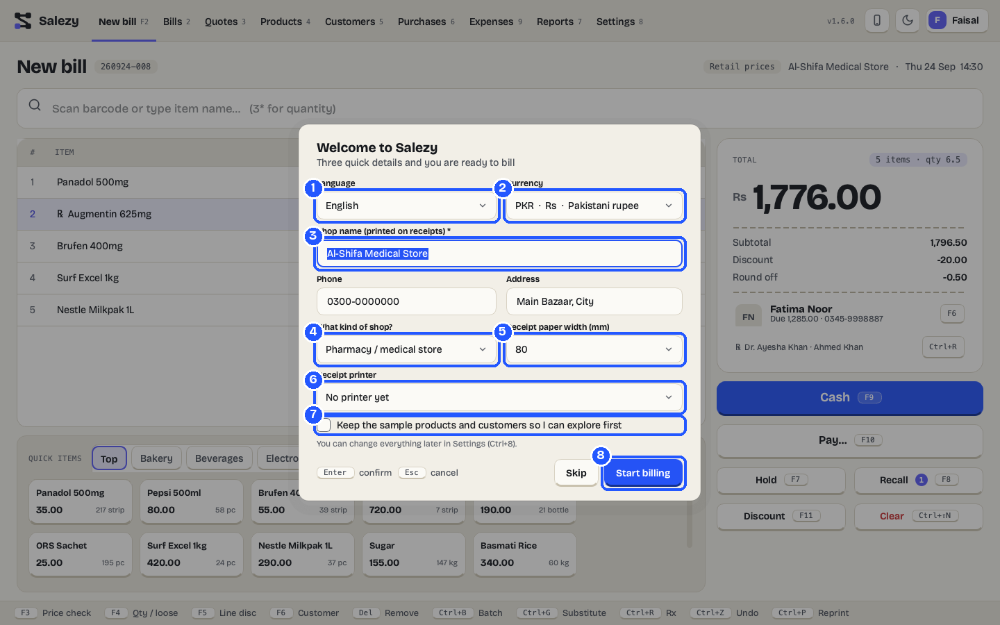

1. **Language:** the language of the whole app. You can change it later.
2. **Currency:** pick yours from the list. It sets the symbol and how many decimals are shown.
3. **Shop name (printed on receipts):** required. Add the phone and address next to it if you want them on receipts.
4. **What kind of shop?** This turns on the right features: a medical store gets batches, expiry and prescriptions; a
   clothing shop gets sizes, colours and selling by the metre.
5. **Receipt paper width (mm):** 58 or 80, the width of your printer's paper.
6. **Receipt printer:** pick one now or later in Settings. **No printer yet** is fine.
7. **Keep the sample products and customers so I can explore first:** tick this to try Salezy with demo products. Leave
   it unticked to start with an empty shop.
8. Click **Start billing**.

**Skip** keeps the sample products and opens the app; you can fill in your details later in **Settings** (Ctrl+8).

## 4. Logging in

Login is off until you add a user with a PIN (see [section 40](#40-users-and-pins)). Once there is one, Salezy asks who
is at the counter every time it starts.

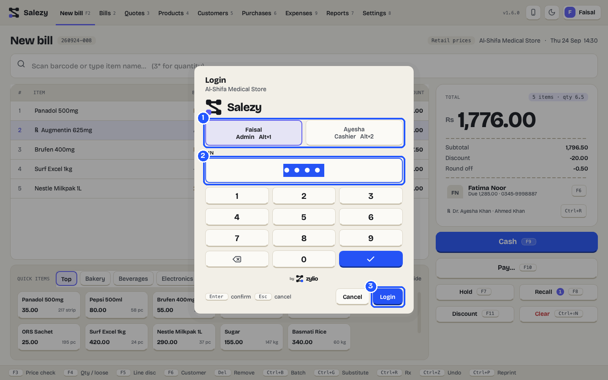

1. Click your name, or press **Alt+1**, **Alt+2** and so on.
2. Type your PIN on the keyboard, or tap the number keys on a touch screen.
3. Click **Login**, or press **Enter**.

Click your name in the top right of the app, or press **Ctrl+Shift+L**, to hand the counter to someone else without
closing the bill in progress.

## 5. A tour of the counter

Salezy opens on **New bill**, the counter screen. This is where you spend most of the day.

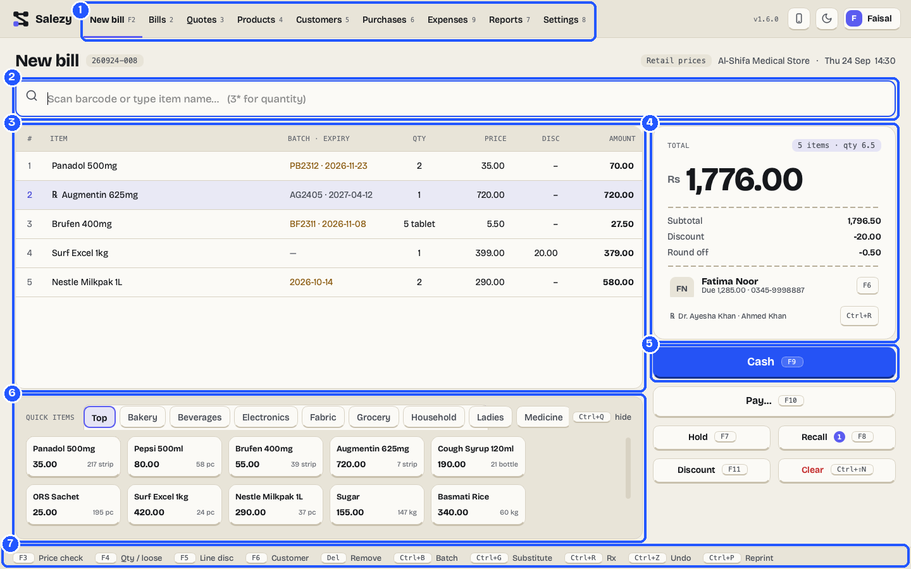

1. **The screens**, along the top. Each tab shows its shortcut: **F2** for New bill, then **Ctrl+2** for Bills,
   **Ctrl+3** Quotes, and so on. On the right are the phone scanner, light/dark, and the person logged in.
2. **The search box.** The cursor always comes back here. Scan a barcode or type part of a name.
3. **The bill.** Each line shows the item, its batch and expiry (in a medical store), quantity, price, discount and
   amount. Dates in amber expire within 90 days; dates in red have passed.
4. **The total**, set like a receipt: the amount to pay, the subtotal, discount and round-off, then the customer (F6)
   and the prescription (Ctrl+R).
5. **Cash** (F9): the one blue key. It takes the exact amount in cash and saves the bill.
6. **Quick items:** buttons for things that have no barcode, like loose sugar or bread.
7. **The key strip** at the bottom lists the shortcuts for this screen.

Below Cash are **Pay…** (F10) for other ways to pay, **Hold** (F7), **Recall** (F8, with the number of bills on hold),
**Discount** (F11) and **Clear** (Ctrl+Shift+N).

---

# Part 2. Make a bill

## 6. Add items: scan or search

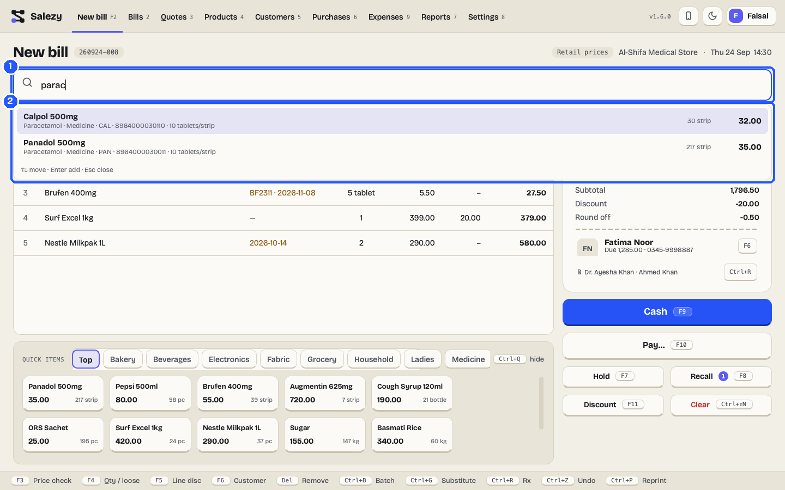

1. Scan the barcode. The item is added to the bill at once. Scan it again to add one more.
2. Or type part of the name, the short code or the generic name. A list appears; use the **↑** and **↓** keys and press
   **Enter**, or click an item.

To add several at once, type the quantity and a star before scanning or searching: `3*` then scan adds three.

If you scan something Salezy does not know, it says so. Press **Ctrl+N** to add it as a new product there and then.

## 7. Change a quantity, sell loose, or remove a line

Click a line, or move to it with the arrow keys, then:

- **+** and **−** add or take away one.
- **F4** or **Enter** opens the quantity.
- **Del** removes the line. **Ctrl+Z** undoes the last change.
- **Ctrl+E** changes the price of this line by hand.

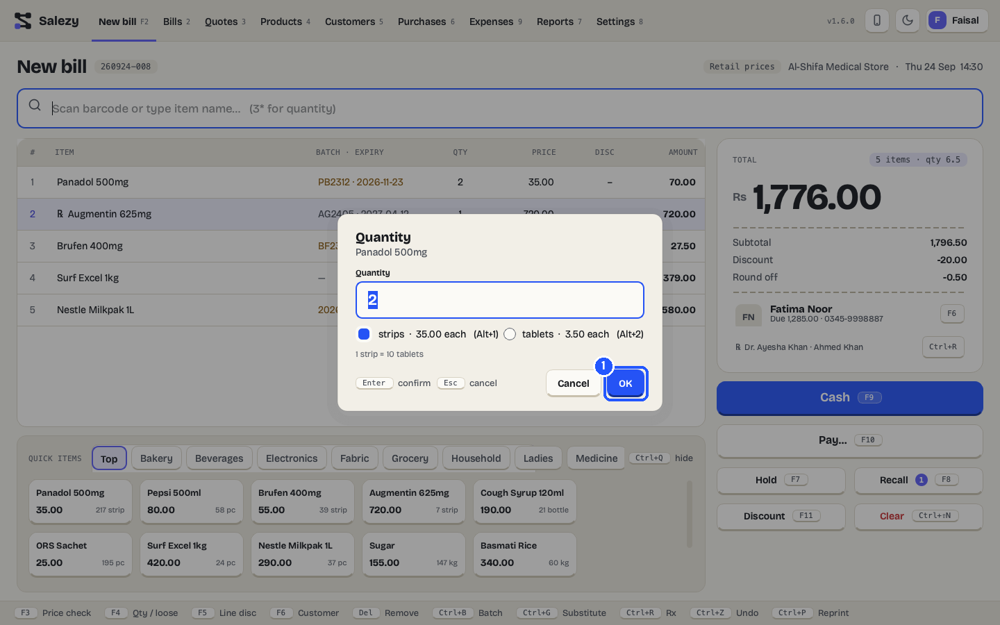

1. Type the quantity and click **OK**. For a medicine sold by the strip and by the tablet, choose **strips** or
   **tablets** (Alt+1 or Alt+2): Salezy works out the price per tablet and keeps the stock exact.

## 8. Discounts

- **F5** gives a discount on the line you are on.
- **Discount** (F11) gives a discount on the whole bill.

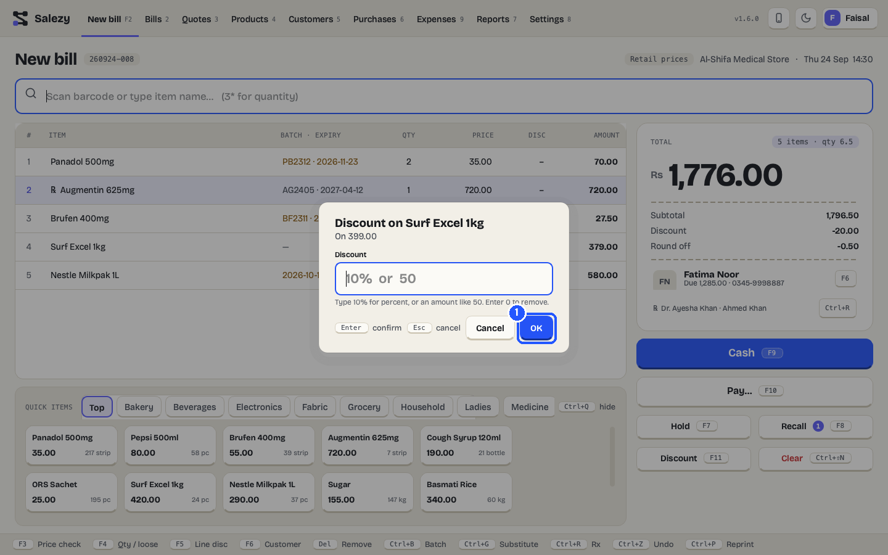

1. Type a percentage like `10%`, or an amount like `50`, and click **OK**. Type `0` to remove a discount.

Prescription-only medicines cannot be discounted.

## 9. Choose the customer

A bill is for a walk-in customer unless you choose one. Press **F6**, or click the customer row under the total.

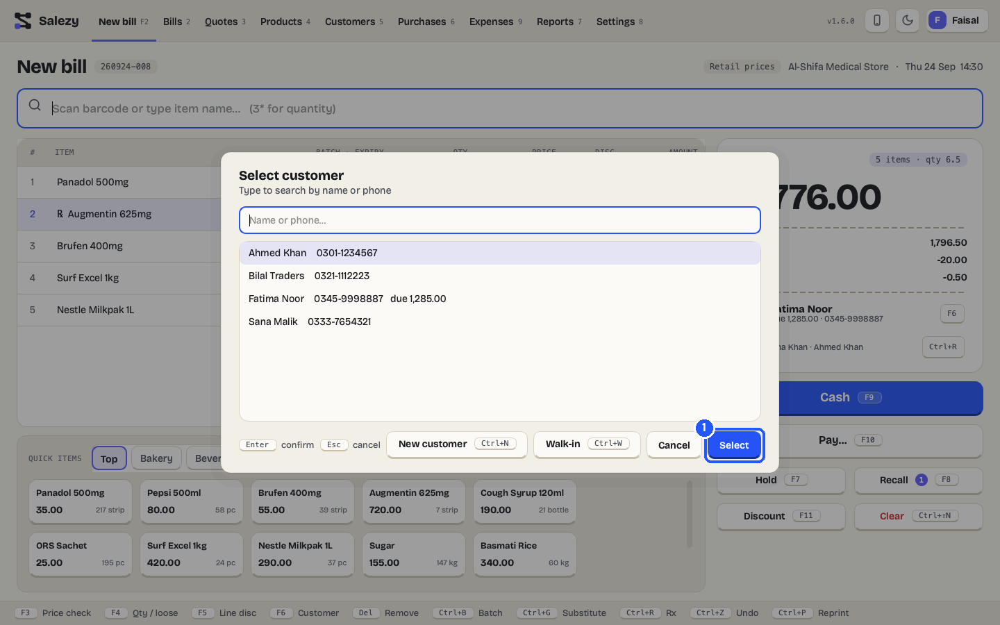

1. Type part of the name or phone number, pick the customer and click **Select**. **New customer** (Ctrl+N) adds one;
   **Walk-in** (Ctrl+W) goes back to no customer.

The customer's dues show under their name, and a customer can be set to get wholesale prices (see
[section 15](#15-retail-and-wholesale-prices)).

## 10. Take payment

For the most common sale, press **Cash** (F9): the bill is paid in exact cash and saved. For anything else, press
**Pay…** (F10).

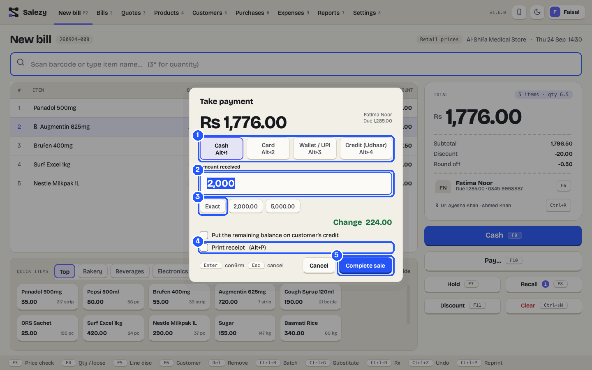

1. Choose how they pay: **Cash**, **Card**, **Wallet / UPI** or **Credit (Udhaar)**. Alt+1 to Alt+4 do the same.
2. For cash, type the **Amount received**. Salezy shows the change to give back.
3. Or click one of the quick amounts, such as **Exact** or the next round note.
4. Tick **Print receipt** (Alt+P) to print it.
5. Click **Complete sale**, or press **Enter**.

For card and wallet payments you can type a reference, such as the last 4 digits of the card. If the customer pays less
than the total, tick **Put the remaining balance on customer's credit**: what they paid is taken, and the rest goes on
their credit.

After saving, the bill number and total appear under the keys, and **Ctrl+P** reprints that last bill.

## 11. Sell on credit (udhaar)

Choose the customer first (F6). A walk-in customer cannot buy on credit.

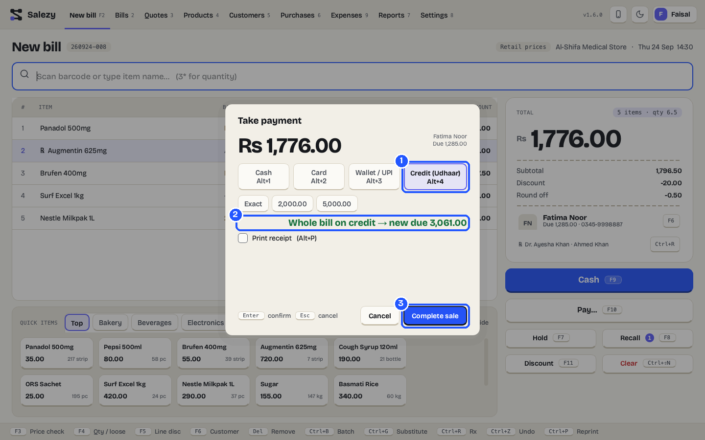

1. In **Pay…**, choose **Credit (Udhaar)**.
2. Salezy shows what the customer will owe after this bill.
3. Click **Complete sale**.

Everything the customer owes is in their ledger on the Customers screen (see [section 31](#31-customers-and-their-credit)).

## 12. Hold a bill and recall it

When a customer steps away, press **Hold** (F7). The bill is parked and the counter is free for the next person. Held
bills do not touch the stock.

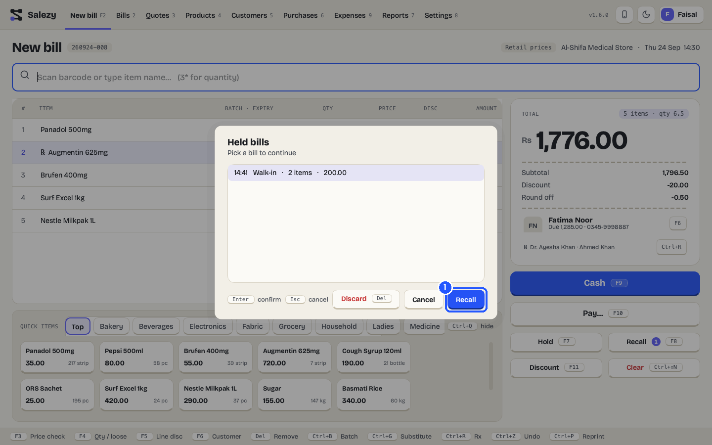

1. Press **Recall** (F8), pick the bill and click **Recall**. **Discard** (Del) throws a held bill away.

If there is already a bill in progress, Salezy holds it first, so nothing is lost.

## 13. Quick items: things without a barcode

The quick items under the bill are buttons for loose goods and counter items. **Top** shows what you sell most.

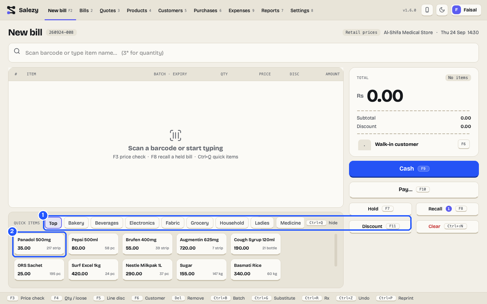

1. Click a category to see its items.
2. Click an item to add one to the bill.

**Ctrl+Q** hides or shows the quick items.

## 14. Check a price without selling

Press **F3** when a customer asks "how much is this?".

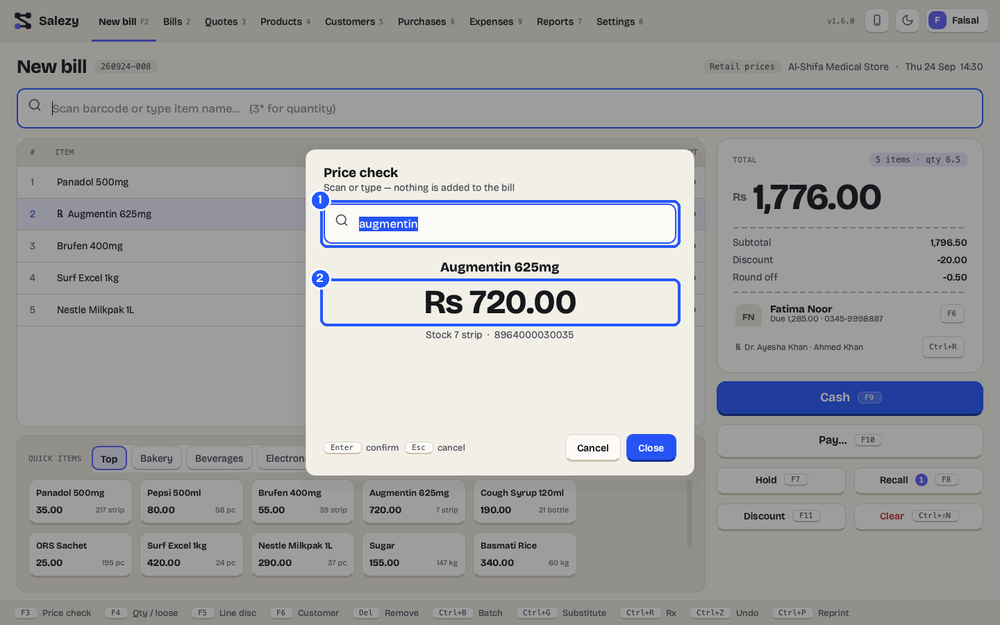

1. Scan the item or type its name.
2. The price shows in large figures, with the stock, MRP, expiry and barcode under it. Nothing is added to the bill.

## 15. Retail and wholesale prices

Each product can have a wholesale price as well as its sale price. Press **Ctrl+Shift+W** to switch the whole bill
between them.

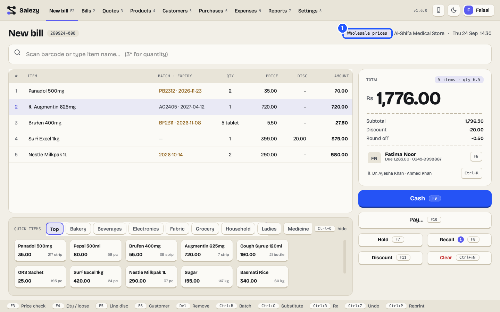

1. The label above the bill shows **Retail prices** or **Wholesale prices**.

A customer can be set to get wholesale prices automatically (edit the customer on the Customers screen). A line whose
price you changed by hand keeps that price when you switch.

## 16. Quotations and delivery challans

At the counter, with items on the bill:

- **Ctrl+Shift+Q** saves it as a **quotation**: a price for the customer, with a date it is valid until. Nothing leaves
  stock.
- **Ctrl+Shift+C** saves it as a **delivery challan**: the goods leave stock now, and the bill follows later.

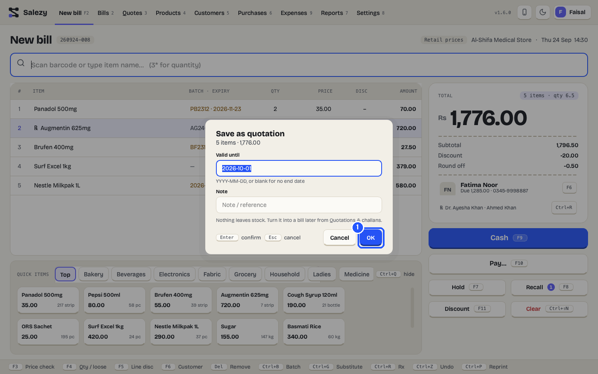

1. Set **Valid until** (or leave it blank for no end date), add a note if you like, and click **OK**. It prints, and
   the counter is cleared.

The **Quotes** screen (Ctrl+3) lists them all.

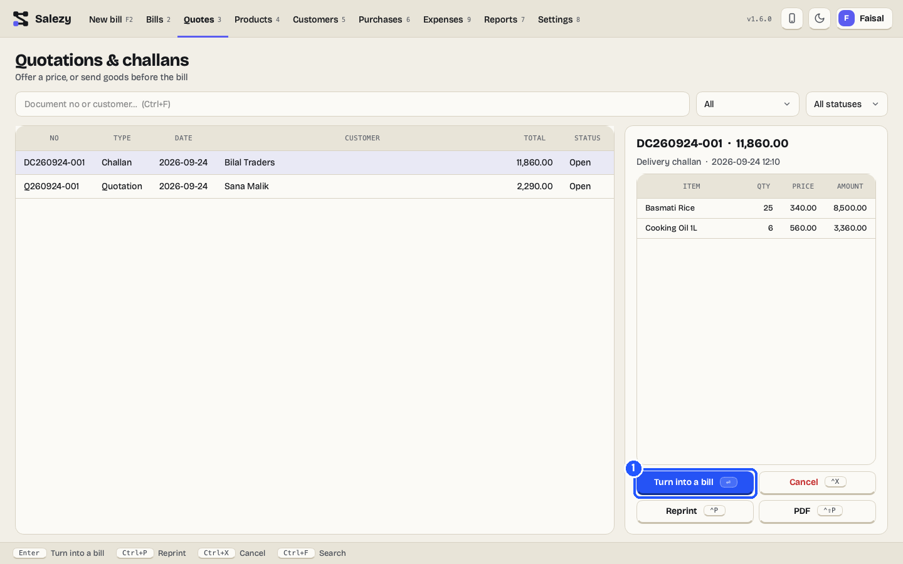

1. Select one and click **Turn into a bill** (or press Enter) to load it at the counter, then take payment as usual.

A document can become a bill only once. A quotation keeps the prices it was given, even if you change prices later. An
expired quotation is shown as **Expired** and asks you to confirm before you use it. A challan's goods are not taken
from stock a second time when it is billed.

## 17. Use a phone as the barcode scanner

A phone on the shop's Wi-Fi can scan barcodes with its camera and add them to the bill on the counter. It works only on
the shop's own network; nothing goes over the internet.

Turn it on once in **Settings** (see [section 43](#43-phone-scanner-settings)), or press **Ctrl+Shift+S** at the counter,
or click the phone button in the top bar.

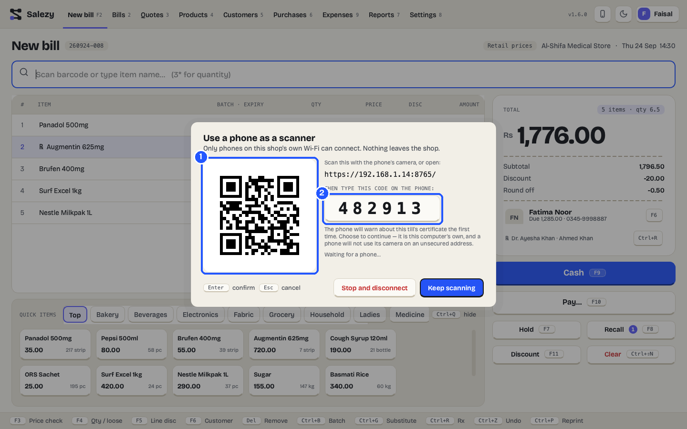

1. Point the phone's camera at the QR code, or type the address shown under it into the phone's browser.
2. Type the six-digit code on the phone and tap **Connect**.

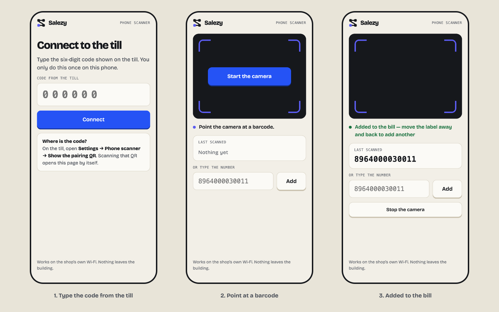

On the phone, tap **Start the camera** and hold the barcode inside the corners. Each item scanned appears on the bill
at the counter. Holding the same label in front of the camera adds it only once; move it away and back to add another.
You can also type a number on the phone and tap **Add**.

The first time, the phone warns that the counter's certificate is not trusted. Choose to continue: the certificate is
the counter computer's own, and phones only allow the camera on a secure address.

**Stop and disconnect** in the pairing window turns it off and disconnects the phone.

## 18. The customer display

If the counter has a second screen facing the customer, press **Ctrl+Shift+D**. A window opens with the lines of the bill
and a very large total.

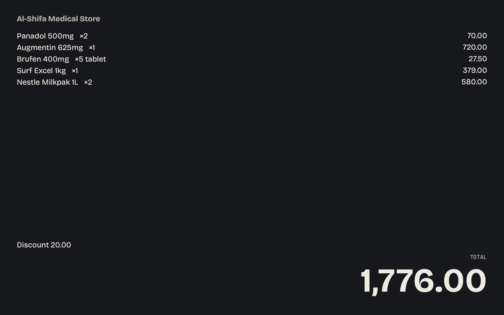

Drag it onto the second screen. Press **Ctrl+Shift+D** again to hide it.

---

# Part 3. Medical stores and clothing shops

## 19. Batches and expiry

In a medical store, each delivery of a medicine is a **batch** with its own expiry date. Salezy sells the batch that
expires first (FEFO: first expiry, first out), and a sale bigger than one batch is taken from the next one.

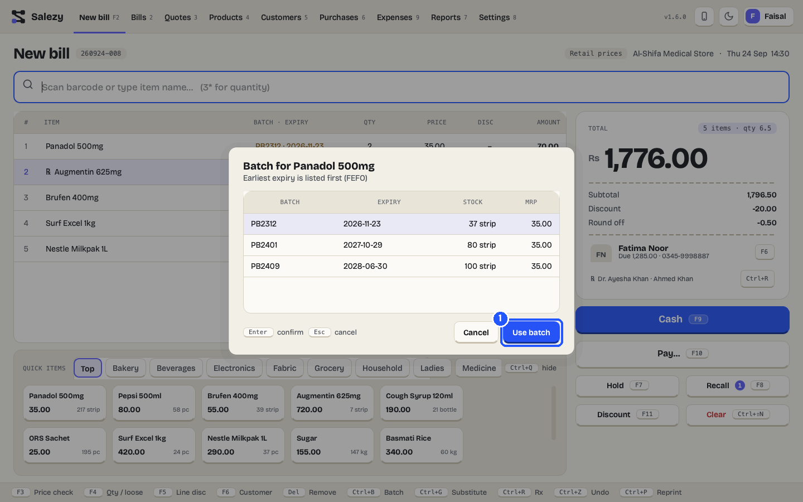

1. To sell from a different batch, click the line and press **Ctrl+B**, pick the batch and click **Use batch**.

An expired item asks you to confirm before it is added. **Expiring ≤ 90 days** on the Reports screen lists what is
coming up.

## 20. Prescriptions and substitutes

A product marked as prescription-only (scheduled) needs the doctor's name before the bill can be saved.

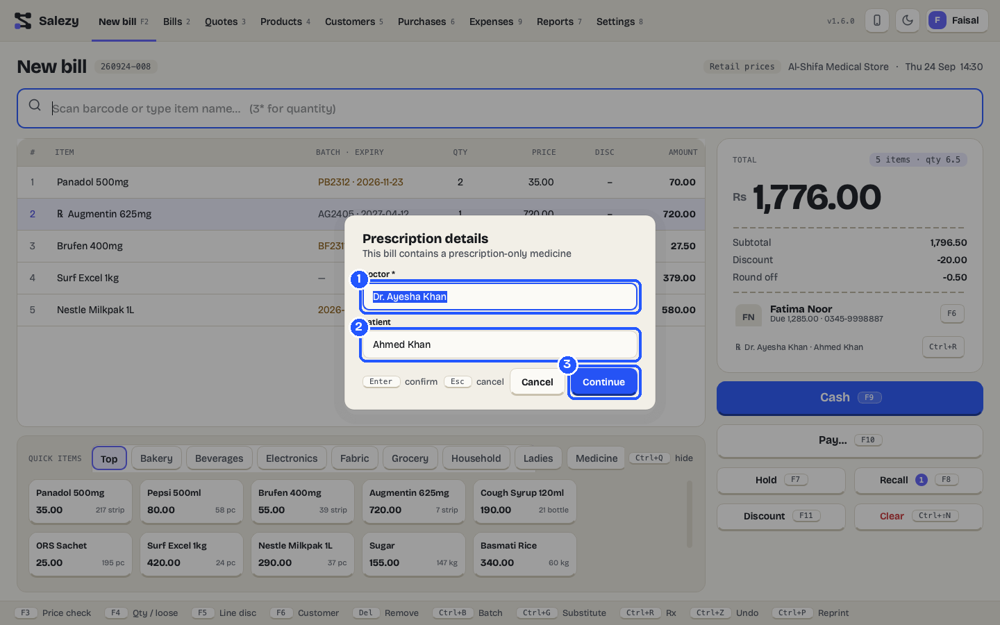

1. Type the **Doctor** name.
2. Type the **Patient** name if you want it on the receipt.
3. Click **Continue**.

**Ctrl+R** opens the prescription details at any time. The doctor and patient show under the total and print on the
receipt.

**Ctrl+G** shows substitutes for the line you are on: other medicines with the same generic name (salt). Set the
generic name on each product to use it.

## 21. Sizes, colours and selling by the metre

In a clothing shop, a style such as a polo shirt has one product for each size and colour, each with its own stock.
Fabric and ribbon are sold by the metre or yard, with decimals.

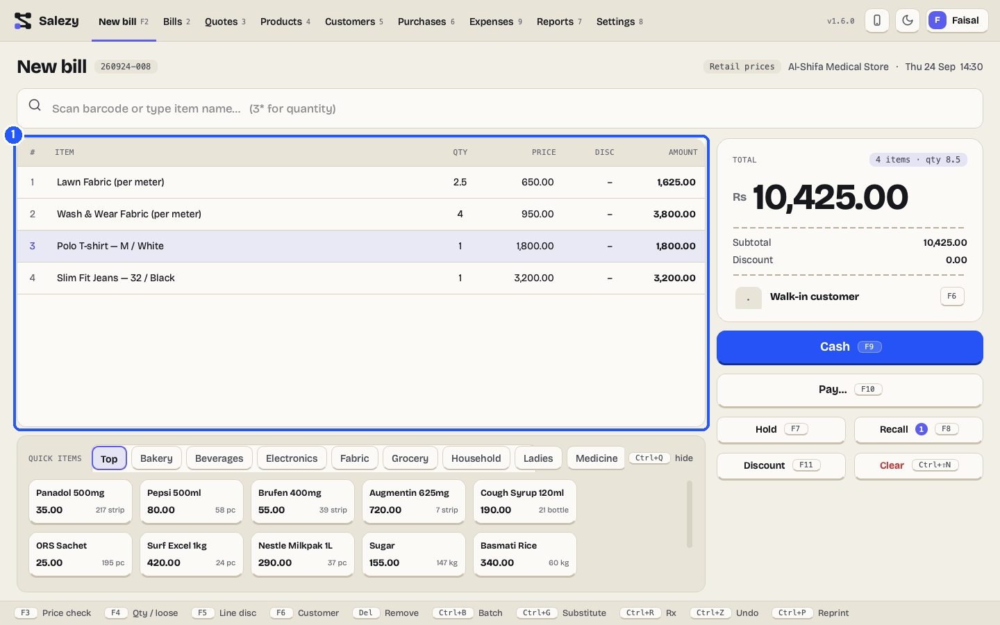

1. Fabric shows the metres sold, for example **2.5**.

When you scan or pick a style, Salezy asks which one:

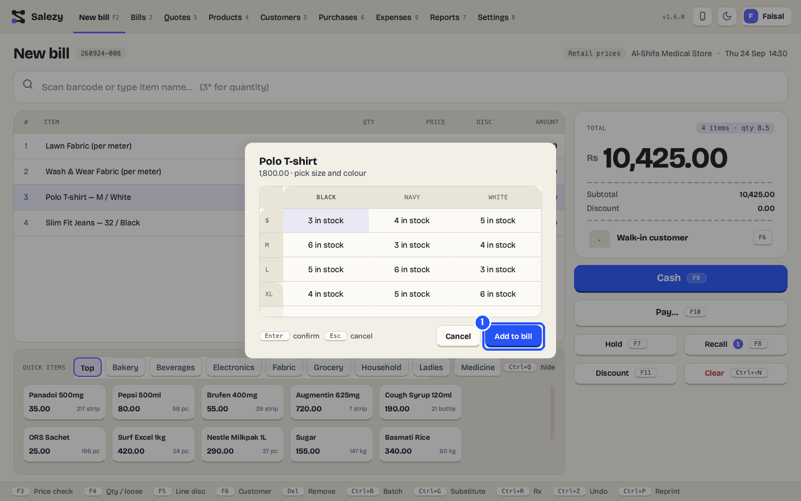

1. Click the size and colour, then **Add to bill**.

To set up the sizes and colours, see [section 27](#27-add-or-edit-a-product).

---

# Part 4. After the sale

## 22. Find a bill and reprint it

The **Bills** screen (Ctrl+2) lists every bill, with the selected one shown as its receipt.

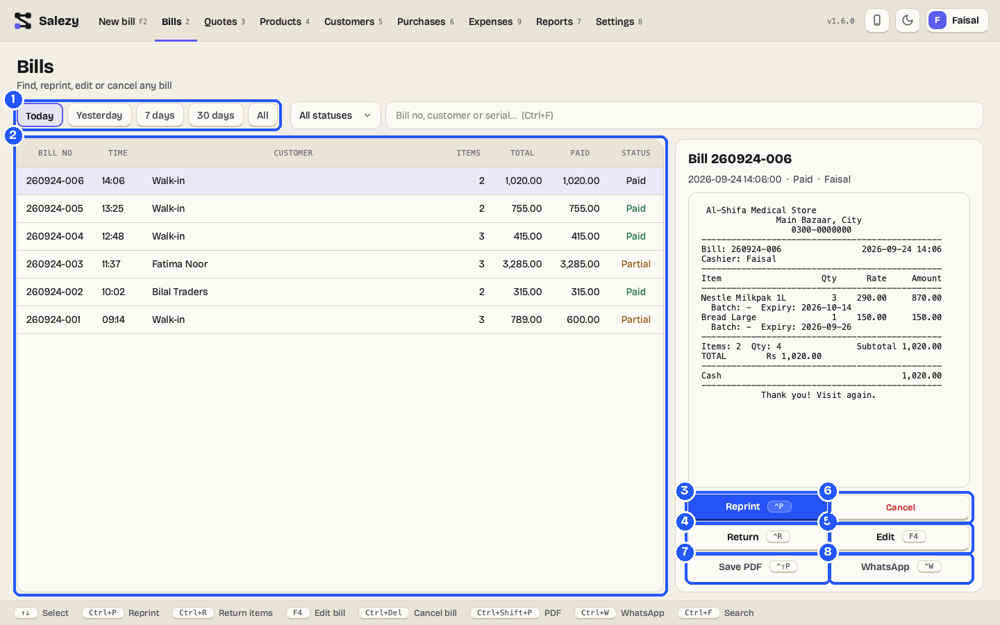

1. Choose the days to show: **Today**, **Yesterday**, **7 days**, **30 days** or **All**. You can also filter by status
   and search by bill number, customer or serial number (Ctrl+F).
2. Click a bill to see its receipt.
3. **Reprint** (Ctrl+P) prints it again, marked as a copy.
4. **Return** (Ctrl+R): see [section 23](#23-returns).
5. **Edit** (F4): see [section 24](#24-edit-or-cancel-a-bill).
6. **Cancel** (Ctrl+Del): see [section 24](#24-edit-or-cancel-a-bill).
7. **Save PDF** (Ctrl+Shift+P): see [section 25](#25-send-a-bill-as-a-pdf-or-on-whatsapp).
8. **WhatsApp** (Ctrl+W): see [section 25](#25-send-a-bill-as-a-pdf-or-on-whatsapp).

## 23. Returns

Select the bill on the Bills screen and click **Return** (Ctrl+R).

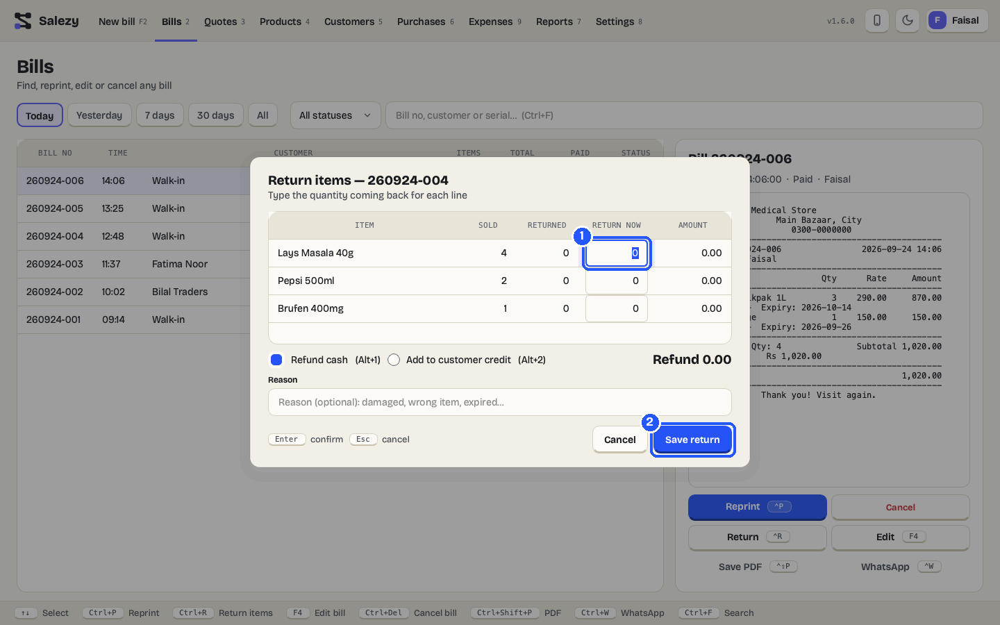

1. Type how many of each item are coming back. Salezy will not let you return more than was sold, counting earlier
   returns.
2. Choose **Refund cash** (Alt+1) or **Add to customer credit** (Alt+2), add a reason if you like, and click
   **Save return**.

The items go back into stock, into the batch they came from.

## 24. Edit or cancel a bill

- **Edit** (F4) opens the bill at the counter. Change it and save with **Cash** (F9) or **Pay…** (F10). The stock is
  corrected.
- **Cancel** (Ctrl+Del) cancels a bill with a reason. Its items go back into stock, and it stays in the list marked
  **Cancelled**.

Only an admin can edit or cancel a bill.

## 25. Send a bill as a PDF or on WhatsApp

- **Save PDF** (Ctrl+Shift+P) saves the bill as an A5 invoice PDF you can email, share or print on an ordinary
  printer.
- **WhatsApp** (Ctrl+W) opens WhatsApp in your browser with a summary of the bill, addressed to the customer's phone
  number. You then press send in WhatsApp. This one needs the internet.

---

# Part 5. Stock, customers and suppliers

## 26. The Products screen

**Products** (Ctrl+4) lists everything you sell, with its stock, cost, price, MRP and the next expiry.

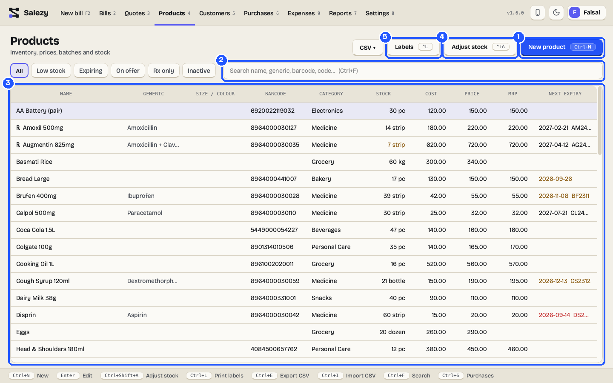

1. **New product** (Ctrl+N) adds one: see [section 27](#27-add-or-edit-a-product).
2. Search by name, generic name, barcode or code (Ctrl+F). The buttons above the list show only low stock, expiring,
   on offer, prescription-only or inactive products.
3. Double-click a product, or press **Enter**, to edit it.
4. **Adjust stock** (Ctrl+Shift+A): see [section 28](#28-correct-the-stock).
5. **Labels** (Ctrl+L): see [section 29](#29-barcode-labels).

Stock in amber is at or under its low-stock alert.

## 27. Add or edit a product

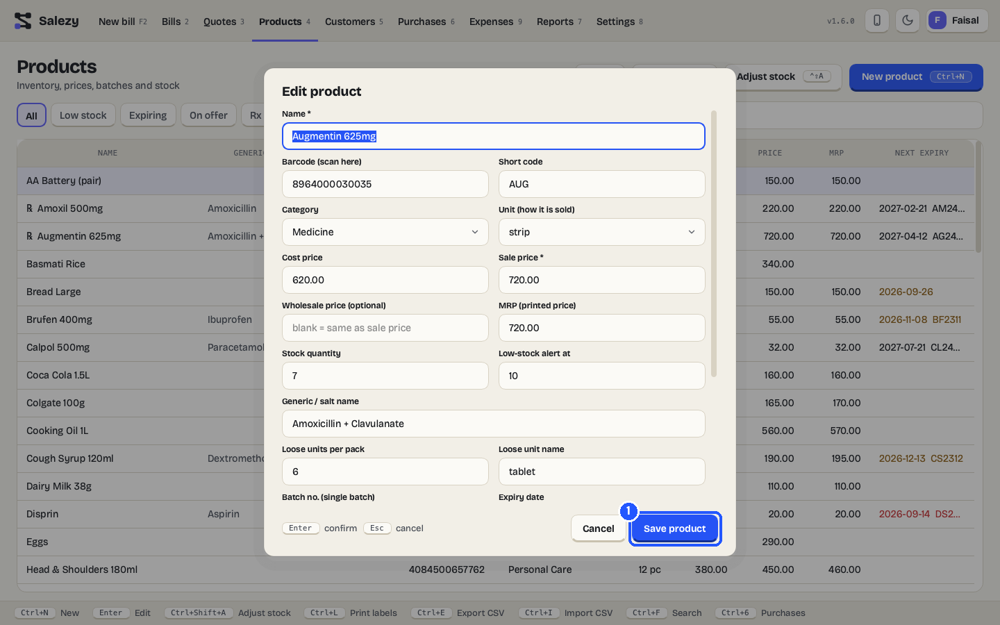

Fill in what you need; only the **Name** and **Sale price** are required. The rest:

- **Barcode** (scan it into the box), **Short code** (a few letters to type at the counter, like `PAN`), **Category** and
  **Unit**.
- **Cost price**, **Sale price**, **Wholesale price** and **MRP**. Profit in the reports uses the cost.
- **Stock quantity** and **Low-stock alert at**.
- In a medical store: the **Generic / salt name**, **Loose units per pack** (for example 10 tablets in a strip), the
  batch and expiry, and **Scheduled / prescription-only drug**.
- In a clothing shop: type the sizes and colours (comma separated) to create one product for each combination.
- An **Offer price** with an end date, **Ask for serial / IMEI number on every sale** for phones and electronics, and
  **Active** (an inactive product does not appear when billing).

1. Click **Save product**.

The form scrolls when it is taller than your screen.

## 28. Correct the stock

Select the product and click **Adjust stock** (Ctrl+Shift+A).

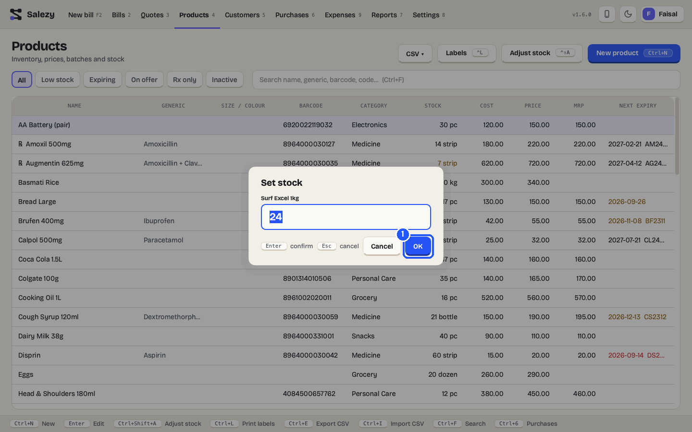

1. Type the quantity you actually have and click **OK**.

A medicine kept in batches gets its stock from purchases instead (see [section 34](#34-enter-a-suppliers-invoice)).

## 29. Barcode labels

Select the products and click **Labels** (Ctrl+L).

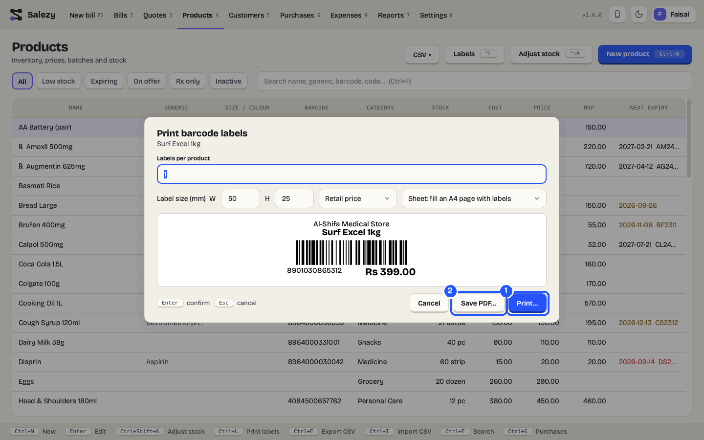

Set how many labels per product, the label size in millimetres, and which price to show; the preview updates as you go.

1. **Print…** sends them to a label printer.
2. **Save PDF…** makes an A4 sheet of labels to print on any printer.

## 30. Import and export products

The **CSV** menu on the Products screen exports every product to a spreadsheet file (Ctrl+E) and imports products from
one (Ctrl+I). A file exported from Salezy can be edited and imported again: products with the same barcode or name are
updated, and new ones are added.

## 31. Customers and their credit

**Customers** (Ctrl+5) lists your customers with what each one owes.

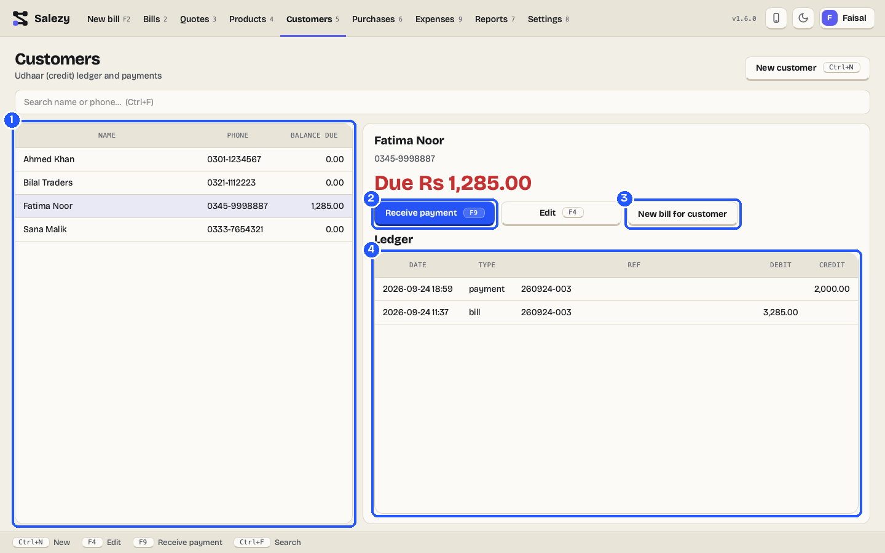

1. Click a customer.
2. **Receive payment** (F9): see [section 32](#32-receive-a-payment-from-a-customer).
3. **New bill for customer** opens the counter with this customer already chosen.
4. The **Ledger** shows every bill and payment, with the date and amounts.

**New customer** (Ctrl+N) adds a customer, and **Edit** (F4) changes their name, phone, address and whether they get
wholesale prices.

## 32. Receive a payment from a customer

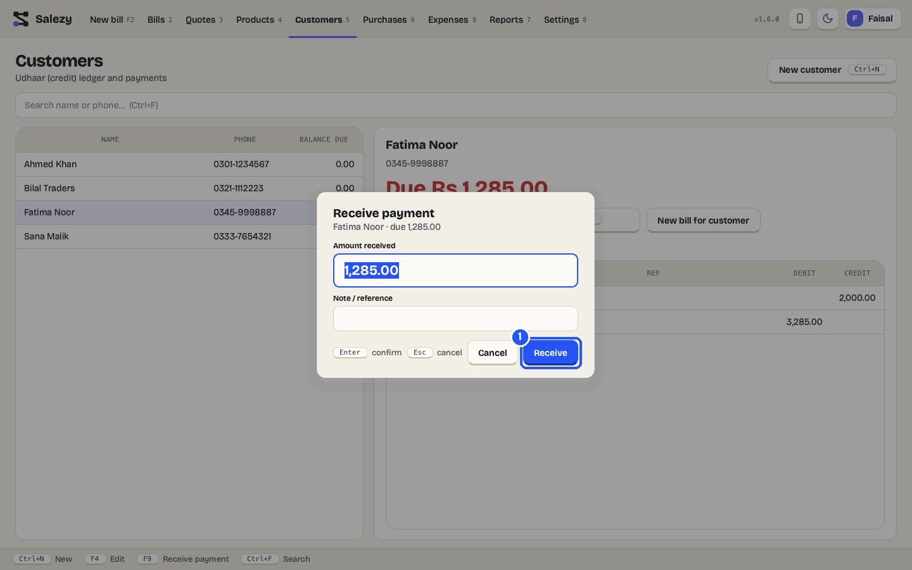

1. Type the amount received (Salezy fills in what they owe), add a note if you like, and click **Receive**. The payment
   appears in their ledger and lowers what they owe.

## 33. Purchases: stock from suppliers

**Purchases** (Ctrl+6) lists the invoices from your suppliers, with what you still owe on each.

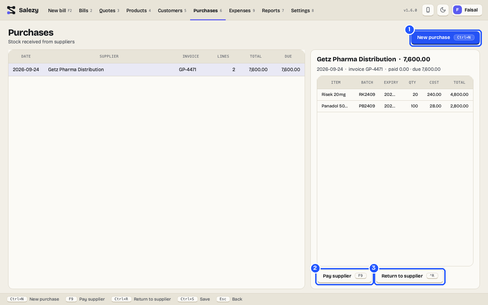

1. **New purchase** (Ctrl+N): see [section 34](#34-enter-a-suppliers-invoice).
2. **Pay supplier** (F9): see [section 35](#35-pay-a-supplier-or-return-goods).
3. **Return to supplier** (Ctrl+R): see [section 35](#35-pay-a-supplier-or-return-goods).

Purchases, Reports, Settings and Expenses open only for an admin.

## 34. Enter a supplier's invoice

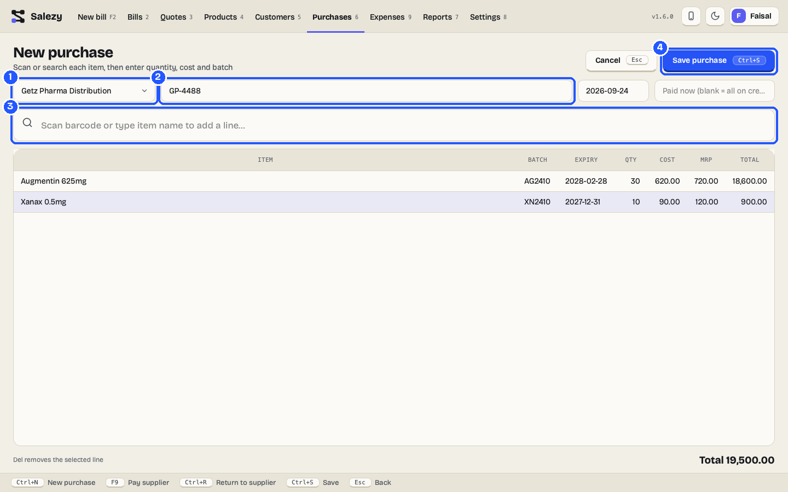

1. Choose the supplier, or type a new name.
2. Type the invoice number. The date is today; change it if the invoice is older.
3. Scan or search each item. For each one, type the quantity, cost and MRP, and in a medical store the batch and expiry.
   **Del** removes the selected line.
4. Click **Save purchase** (Ctrl+S).

The stock goes up straight away. In **Paid now**, type what you paid the supplier on the spot. Leave it blank if you
have not paid yet: the whole invoice is then owed, and shows on the Purchases screen until you pay it.

## 35. Pay a supplier or return goods

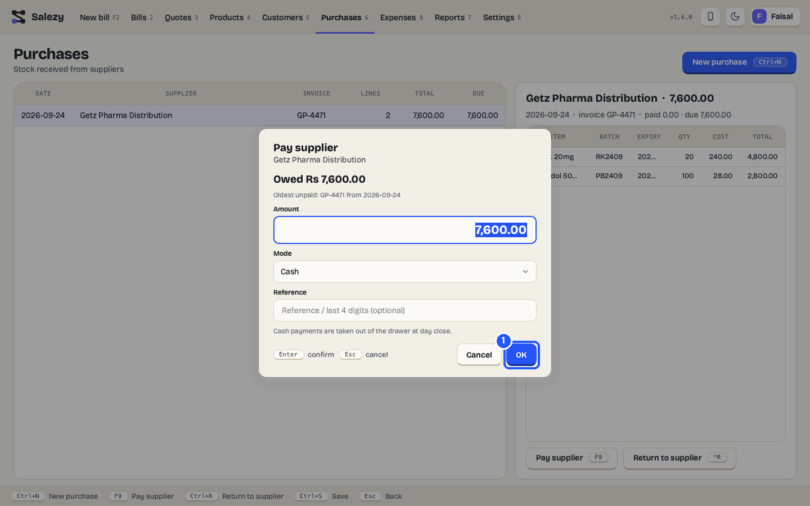

1. Select the supplier's invoice, click **Pay supplier** (F9), check the amount, choose how you paid, and click **OK**.
   The payment settles the oldest unpaid invoice first. A cash payment is taken out of the drawer at day close.

**Return to supplier** (Ctrl+R) sends goods back against an invoice: pick the quantities and give a reason. The stock
leaves the batch it came in, and what you owe goes down.

## 36. Expenses

**Expenses** (Ctrl+9) records money that leaves the shop for anything other than stock: rent, bills, tea, transport.

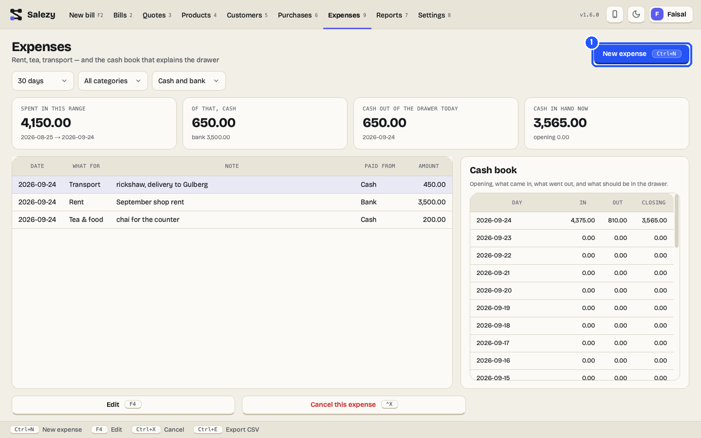

1. Click **New expense** (Ctrl+N).

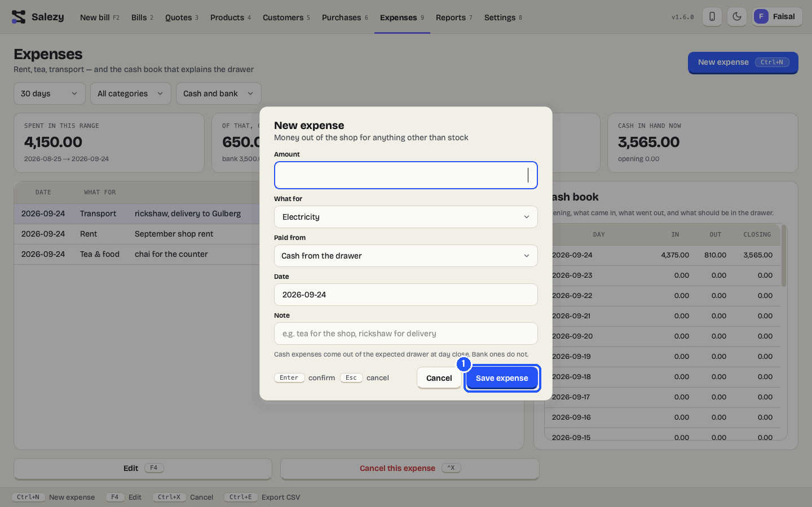

1. Type the amount, choose what it was for and whether it came from the drawer or the bank, and click **Save expense**.

A cash expense comes out of the expected cash at day close. The **cash book** on the right shows, day by day, what came
in and what went out of the drawer.

---

# Part 6. Money and reports

## 37. Reports

**Reports** (Ctrl+7) shows how the shop is doing.

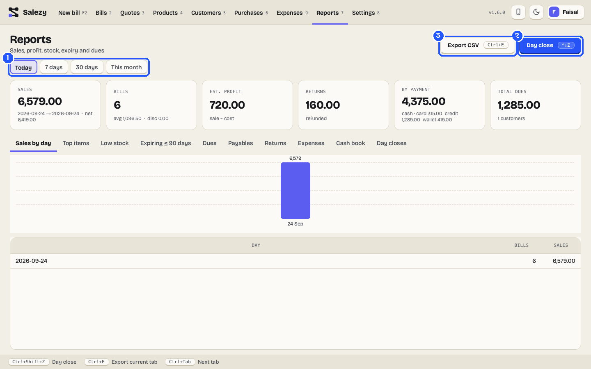

1. Choose the period: **Today**, **7 days**, **30 days** or **This month**.
2. **Day close** (Ctrl+Shift+Z): see [section 38](#38-close-the-day).
3. **Export CSV** (Ctrl+E) saves the tab you are looking at as a spreadsheet file.

At the top are the sales, bills, profit (sale minus cost), returns, payments by type and the total dues. The tabs below
are: Sales by day, Top items, Low stock, Expiring ≤ 90 days, Dues, Payables (what you owe suppliers), Returns,
Expenses, Cash book and Day closes. **Ctrl+Tab** moves to the next tab.

## 38. Close the day

At the end of the day, count the cash in the drawer and press **Day close** on the Reports screen.

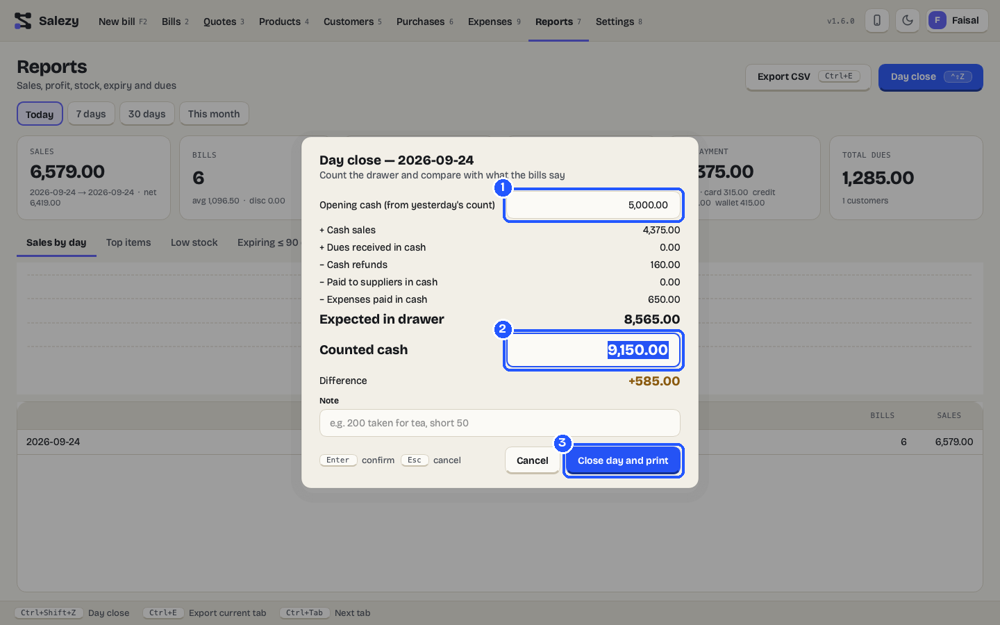

1. Check the **Opening cash**: what was in the drawer at the start of the day.
2. Type the **Counted cash**. Salezy shows the difference from what the bills, payments, refunds and expenses say
   should be there.
3. Add a note about any difference, and click **Close day and print**.

The day close prints as a Z report and is kept in **Day closes** on the Reports screen. Only an admin can close the day.

---

# Part 7. Settings

**Settings** (Ctrl+8) holds everything about your shop. Change what you need and click **Save** (Ctrl+S).

## 39. Shop details and billing

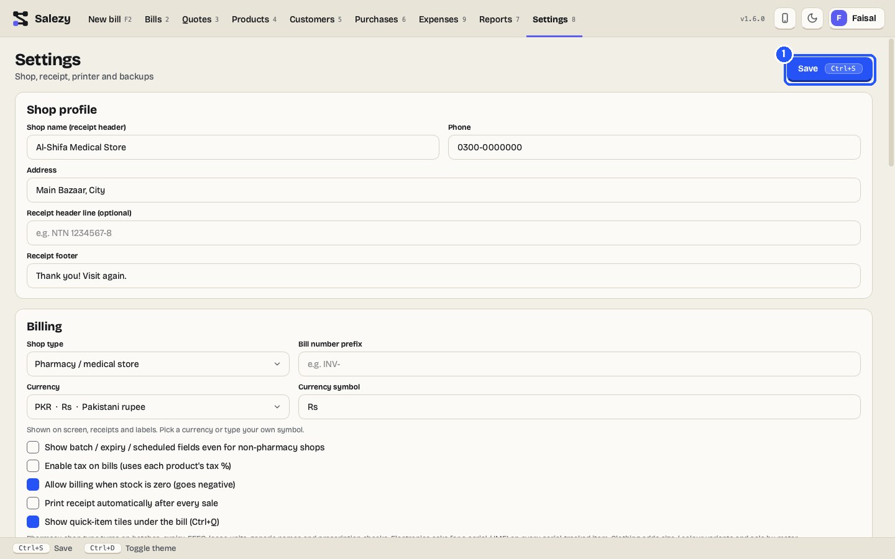

1. **Save** (Ctrl+S) saves all the settings on the page.

- **Shop profile:** the shop name, phone and address printed at the top of receipts, an optional extra header line (for
  example a tax number) and the receipt footer.
- **Billing:** the shop type, a prefix for bill numbers, the currency and its symbol, and these switches: show batch and
  expiry fields in any shop, add tax to bills (using each product's tax %), allow billing when stock is zero, print a
  receipt after every sale, and show the quick items under the bill.

## 40. Users and PINs

With no users, Salezy opens straight to the counter. Add at least one user with a PIN to require a login.

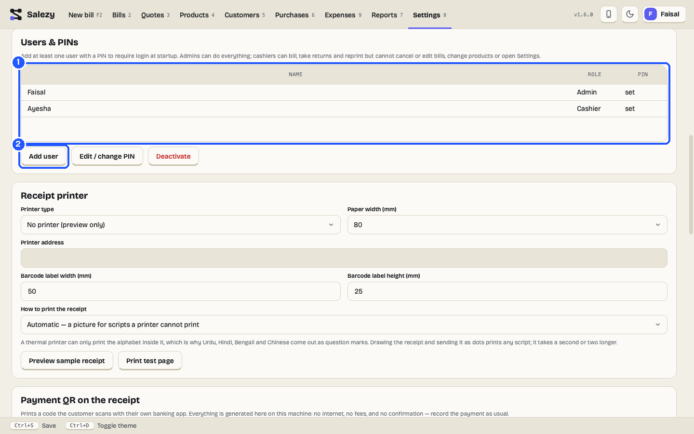

1. The list of users, their role, and whether they have a PIN.
2. Click **Add user**.

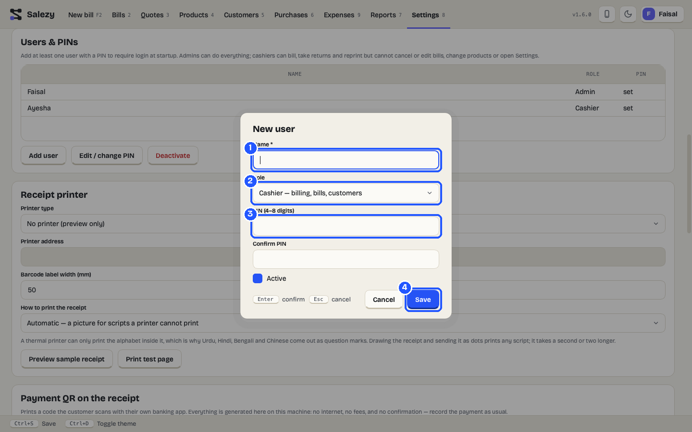

1. Type the name.
2. Choose the **Role**: a **Cashier** can bill, see bills, take returns, reprint and handle customers; an **Admin** can do
   everything, including Settings, purchases, reports, expenses, closing the day, and editing or cancelling bills.
3. Type a PIN of 4 to 8 digits, and the same again to confirm.
4. Click **Save**.

**Edit / change PIN** changes a user, and **Deactivate** stops them logging in.

## 41. The receipt printer

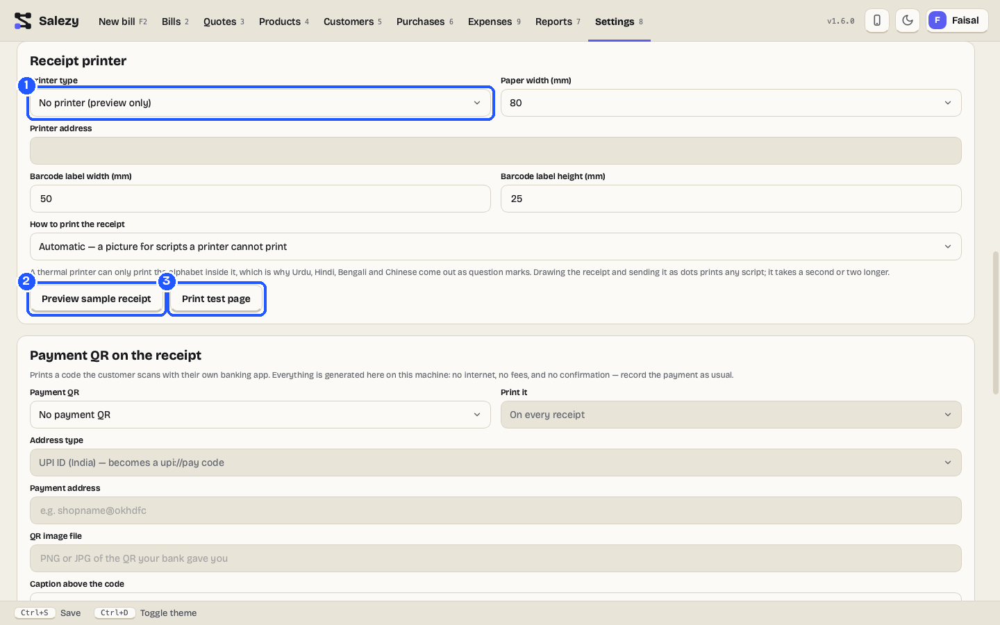

1. **Printer type:** **USB (ESC/POS)**, **Network (ESC/POS, port 9100)**, **Serial / COM (ESC/POS)**, **System printer
   (OS driver)**, or **No printer (preview only)**. Then type the printer's address in the box below; the hint under it
   says what to type.
2. **Preview sample receipt** shows a receipt on screen.
3. **Print test page** prints one.

Choose the paper width (58 or 80 mm) and the label size for barcode labels here too. **How to print the receipt**
matters for languages: a thermal printer can only print the alphabet inside it, so Urdu, Hindi, Bengali, Chinese and
other scripts print as a picture. **Automatic** chooses for you.

On Windows, **System printer** works with any printer that has a Windows driver, including most thermal ones. **USB
(ESC/POS)** talks to the printer directly; Windows needs the WinUSB driver for that.

## 42. A payment QR on the receipt

Salezy can print a QR code at the bottom of the receipt that the customer scans with their own banking app to pay you.

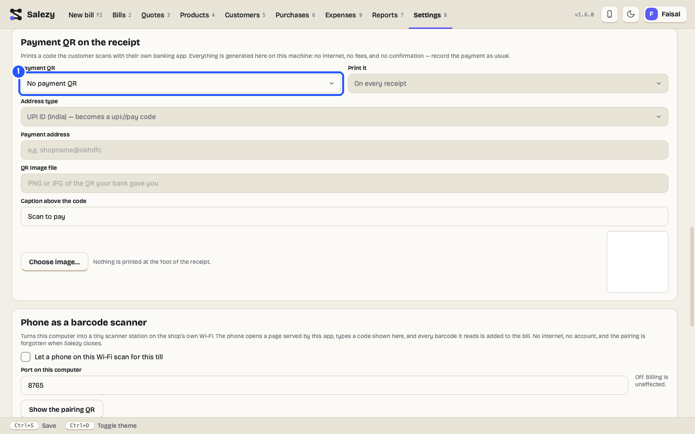

1. Choose **Payment QR**: **No payment QR**, **Generate from a payment address** (choose the **Address type**, such as
   a UPI ID in India or a payment link from your bank, and type your address), or **Use an image of my existing QR**
   (then **Choose image…**).

**Print it** chooses when: **On every receipt**, **Only on unpaid and credit bills**, or **Never print it**. The code is
made on this computer: there is no internet, no fee and no confirmation, so check your bank app for the payment.

## 43. Phone scanner settings

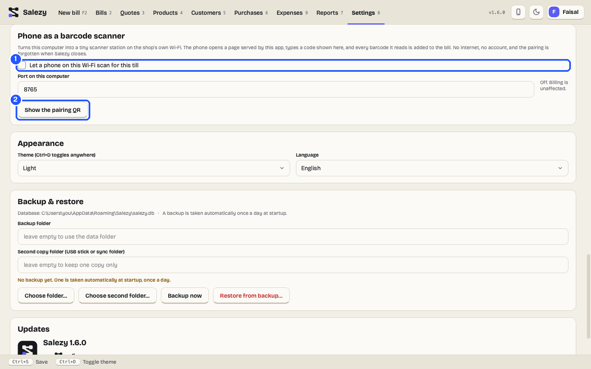

1. Tick **Let a phone on this Wi-Fi scan for this till**. It then starts with Salezy.
2. Click **Show the pairing QR** to connect a phone (see [section 17](#17-use-a-phone-as-the-barcode-scanner)).

The port is 8765 unless you change it. Billing works the same whether this is on or off.

## 44. Light and dark, and languages

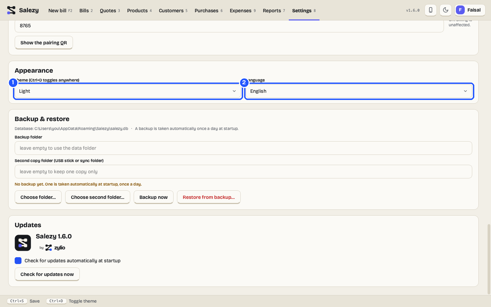

1. **Theme:** Light or Dark. **Ctrl+D** switches anywhere in the app, as does the moon button in the top bar.
2. **Language:** 23 languages. The app changes at once, without restarting, and the bill in progress is kept.

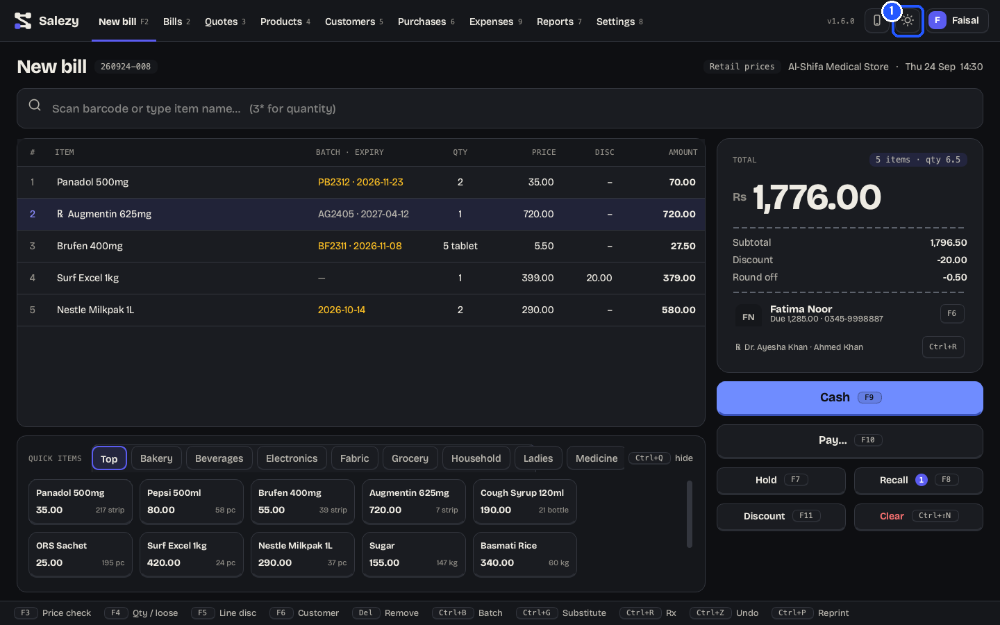

1. The light/dark button in the top bar.

Urdu, Arabic, Persian, Pashto and Punjabi lay the whole app out right to left.

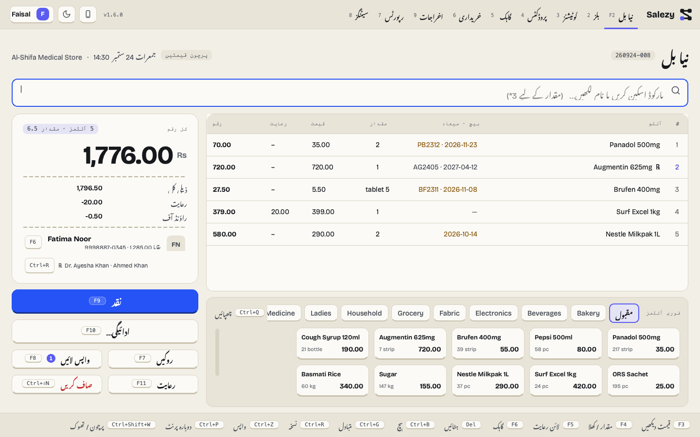

Urdu text uses the Noto Nastaliq Urdu font if your computer has it, and the system's own font if not.

---

# Part 8. Help and upkeep

## 45. Updates

Salezy checks for a new version a few seconds after it starts, when the computer is online. You can turn that off in
**Settings**.

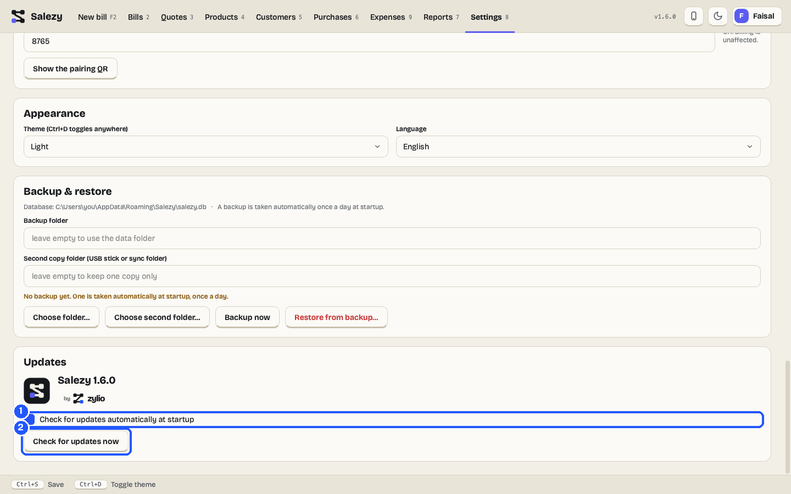

1. **Check for updates automatically at startup** (on by default).
2. **Check for updates now** checks straight away.

When there is a new version, Salezy tells you and shows what is new:

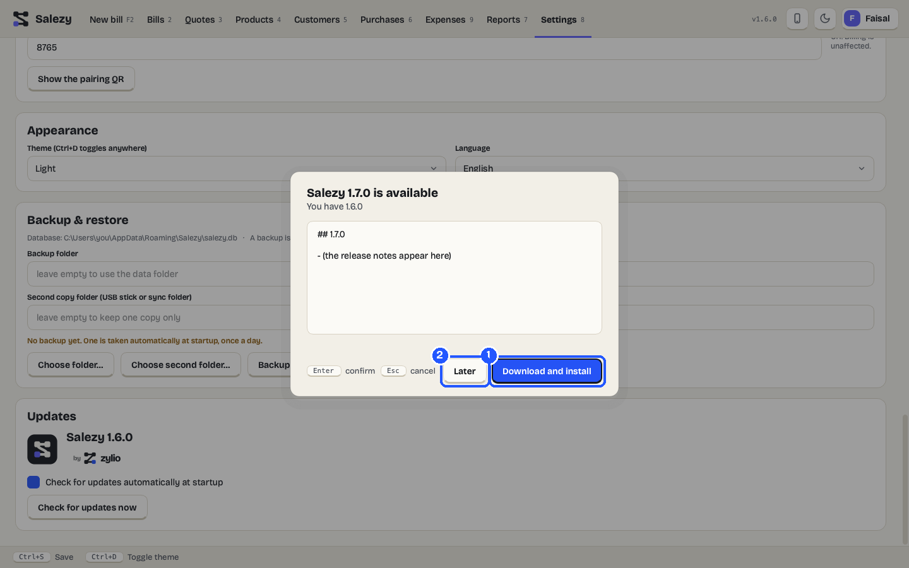

1. **Download and install** downloads it, checks the file is complete, and installs it. On Windows, Windows asks for
   permission first; click **Yes**. Salezy closes, updates itself and opens again. On Linux, the new AppImage replaces
   the old one and starts.
2. **Later** carries on with the version you have. Salezy asks again at the next start.

Updates never touch your data. Nothing is installed without you clicking **Download and install**.

## 46. Your data and backups

Everything is kept in one file on the counter computer:

- **Windows:** `C:\Users\<your name>\AppData\Roaming\Salezy\salezy.db`
- **Linux:** `~/.local/share/Salezy/salezy.db`

Salezy takes a backup automatically once a day, when it starts. It keeps the last 30, plus one from each of the last 12
months.

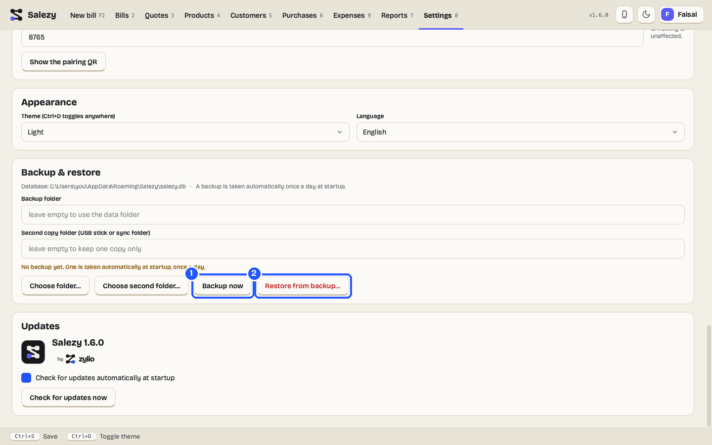

1. **Backup now** takes one straight away.
2. **Restore from backup…** puts back a backup you choose. Salezy shows what is in it first (shop, date, bills and
   products) and asks you to confirm. The current data is replaced and Salezy closes; start it again afterwards.

Choose a **Backup folder** if you want backups somewhere other than the data folder. Set a **Second copy folder** on a
USB stick or a synced folder (Google Drive, OneDrive): every backup is copied there too, so a broken computer does not
take your records with it. The section shows when the last backup was taken, and warns if one failed.

## 47. Keyboard shortcuts

**At the counter**

| Key | Does |
|---|---|
| F2 | New bill (from any screen) |
| F3 | Price check |
| F4 or Enter | Quantity of the selected line |
| F5 | Discount on the selected line |
| F6 | Choose the customer |
| F7 / F8 | Hold the bill / recall a held bill |
| F9 | Cash: take the exact amount and save |
| F10 | Pay… (other ways to pay) |
| F11 | Discount on the whole bill |
| + / − | One more / one less of the selected line |
| Del | Remove the selected line |
| Ctrl+Z | Undo |
| Ctrl+E | Change the price of the selected line |
| Ctrl+B | Choose the batch |
| Ctrl+G | Substitutes (same generic name) |
| Ctrl+R | Prescription details |
| Ctrl+N | Add the item that was not found as a new product |
| Ctrl+P | Reprint the last bill |
| Ctrl+Q | Show or hide quick items |
| Ctrl+Shift+N | Clear the bill |
| Ctrl+Shift+Q / Ctrl+Shift+C | Save as a quotation / as a delivery challan |
| Ctrl+Shift+W | Retail or wholesale prices |
| Ctrl+Shift+S | Phone as a barcode scanner |
| 3* then scan | Add three at once |

**Anywhere**

| Key | Does |
|---|---|
| Ctrl+1 … Ctrl+9 | New bill, Bills, Quotes, Products, Customers, Purchases, Reports, Settings, Expenses |
| Ctrl+D | Light or dark |
| Ctrl+Shift+L | Switch user |
| Ctrl+Shift+D | Customer display |

Each screen lists its own shortcuts in the key strip at the bottom.

## 48. If something goes wrong

- **Windows says "Windows protected your PC" when installing.** Click **More info**, then **Run anyway** (see
  [section 2](#2-install-salezy)).
- **The scanner does nothing.** Click in the search box, then scan. A USB scanner types into whichever box has the
  cursor. Make sure it is set to press Enter after the number (most are).
- **"Only … in stock" when adding an item.** Stock would go below zero. Correct the stock (see
  [section 28](#28-correct-the-stock)), or turn on **Allow billing when stock is zero** in Settings.
- **Nothing prints.** Open Settings, check the printer type and address, and press **Print test page**. If USB does not
  work on Windows, try **System printer** with the printer's own driver.
- **Urdu or Hindi prints as question marks.** Set **How to print the receipt** to **Automatic** (see
  [section 41](#41-the-receipt-printer)).
- **The phone cannot connect.** The phone must be on the same Wi-Fi as the counter. Open the address shown in the pairing
  window, accept the certificate warning, then type the six-digit code. If the camera does not open, the page must be
  the **https** address.
- **"Only an admin can open this screen".** Purchases, Reports, Settings and Expenses need an admin. Press
  **Ctrl+Shift+L** and log in as one.
- **The app closed in the middle of a bill.** Start it again: the bill in progress comes back by itself.
- **The computer broke.** Install Salezy on the new one, then use **Restore from backup…** with a backup from your second
  copy folder (see [section 46](#46-your-data-and-backups)).

## 49. Uninstalling

On Windows, open **Settings → Apps**, find **Salezy** and click **Uninstall**, or use **Uninstall Salezy** in the
Start menu. On Linux, delete the AppImage.

Uninstalling removes the app but keeps your data and backups, so reinstalling brings everything back. To remove the data
too, delete the Salezy data folder (see [section 46](#46-your-data-and-backups)) after making sure you have a backup you
want to keep.

## 50. Words you will see

| Word | Means |
|---|---|
| **Walk-in** | A customer you do not record by name. |
| **Udhaar / credit** | Goods given now and paid for later; it adds to what the customer owes. |
| **Dues** | What a customer owes you. |
| **Payables** | What you owe your suppliers. |
| **Hold / recall** | Park a bill and pick it up again later. |
| **Batch** | One delivery of a medicine, with its own expiry date. |
| **FEFO** | First expiry, first out: the batch that expires first is sold first. |
| **MRP** | Maximum retail price: the price printed on the pack. |
| **Generic / salt name** | The medicine inside, such as paracetamol; used for search and substitutes. |
| **Scheduled / Rx** | A prescription-only medicine. |
| **Loose** | Selling part of a pack, such as single tablets from a strip. |
| **Quotation** | A price offered to a customer, without selling anything. |
| **Delivery challan** | A note for goods sent before the bill; the goods leave stock now. |
| **Day close / Z report** | The end-of-day count of the cash drawer, printed. |
| **Round off** | The small amount added or taken off so the total is a round figure. |
| **Wholesale price** | A lower price for trade customers. |
| **Variant** | One size and colour of a clothing style. |
| **ESC/POS** | The language most receipt printers understand. |
| **Admin / Cashier** | The two kinds of user: an admin can do everything, a cashier can bill. |

## 51. Get help

If you are stuck, write to [support@zylio.net](mailto:support@zylio.net) with what you were doing and a photo or screenshot
of the screen. The **About** line in Settings, under **Updates**, shows which version you have.

Salezy is free, and made by a small team at zylio. If something in this guide doesn't match your screen, tell us at
[support@zylio.net](mailto:support@zylio.net).
